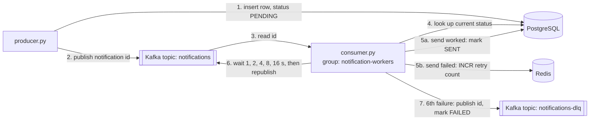

# Kafka Notification System

A notification pipeline in Python that keeps working when things fail: a consumer that crashes, a send that fails, or a message that Kafka delivers twice. Built with Kafka, PostgreSQL, Redis and Docker Compose.

## How it works



1. **The producer writes first, then publishes.** It saves the notification in PostgreSQL as `PENDING`, commits, and only then publishes the notification id to Kafka. Every id on the topic has a row behind it.
2. **The consumer checks the database, not the message.** It reads the id and looks up the current status in PostgreSQL. The message carries only the id, so a stale status can't ride along with it.
3. **`PENDING`:** it tries to send. If the send works, the row becomes `SENT`. The status changes only after the send succeeds.
4. **`SENT` or `FAILED`:** it skips the message. This is what makes a redelivered message harmless.
5. **A failed send is retried with exponential backoff.** The attempt count is kept in Redis with an atomic `INCR`, so it survives a consumer restart. The consumer waits 1, 2, 4, 8, then 16 seconds and republishes the id.
6. **After the sixth failure** the id goes to a dead letter topic, `notifications-dlq`, and the row is marked `FAILED` so it can be looked at by hand.

## Why each piece is there

| Piece | Job | What happens if it's lost |
|---|---|---|
| PostgreSQL | Source of truth for every notification's status | The system can't know what was sent, so it must be durable |
| Kafka | Decouples the producer from the consumer and buffers messages while the consumer is down | Messages are stored on disk, so they wait instead of disappearing |
| Redis | Fast retry counter | The count resets, so a notification may get a few extra retries. The final status is still correct |
| Consumer group `notification-workers` | Kafka saves the consumer's position (offset) under this name | Without it, a restarted consumer starts at the newest message and skips anything sent while it was down |

## Failure cases

| What fails | What happens |
|---|---|
| The consumer is down when a notification is sent | The message waits in Kafka. When the consumer restarts, it resumes from its last saved offset and delivers it |
| Kafka delivers the same message again | The consumer sees `SENT` in PostgreSQL and skips it |
| The send fails | Retried up to five times with backoff (about 31 seconds in total), then moved to the dead letter topic and marked `FAILED` |
| Redis restarts and loses the counter | Retries count from 1 again. More attempts, same final result |
| An id arrives with no matching row | Logged and skipped |

## Known limitations

I'm being honest about these because they're the next things to fix:

- **Crash between sending and marking `SENT`.** If the consumer crashes after the send succeeds but before the status update commits, the message is redelivered and the notification goes out twice. The system is at-least-once, not exactly-once.
- **Producer crash between the database commit and the publish.** The row stays `PENDING` and is never published. A recovery job that republishes old `PENDING` rows would fix this; it isn't built yet.
- **Backoff blocks the consumer.** The wait uses `time.sleep`, so while one notification waits, the next ones wait too.
- **`send_notification` is a stub.** It stands in for a real email or SMS provider. Make it return `False` to watch the retry and dead letter path run.

## Running it

You need Docker and Python 3.

```bash
cd app
cp .env.example .env              # set POSTGRES_USER and POSTGRES_PASSWORD to notif (they match docker-compose.yml)
docker compose up -d
docker compose ps                 # postgres, kafka and redis should all be Up

# create the table (first run only)
docker exec -i postgres psql -U notif -d notifications < init.sql

python3 -m venv venv
source venv/bin/activate
pip install -r requirements.txt

python consumer.py                # terminal 1: leave it running
python producer.py                # terminal 2: sends one notification
```

The consumer prints the notification id, then `delivering` and `delivering success`.

**Try the restart case:** stop the consumer with Ctrl+C, run `python producer.py`, then start the consumer again. It picks up the message it missed.

## Tech

Python (kafka-python, psycopg2, redis-py, python-dotenv) · Apache Kafka 3.8 (KRaft, no ZooKeeper) · PostgreSQL 16 · Redis 7 · Docker Compose. Connection settings live in `.env`, which is kept out of Git.
